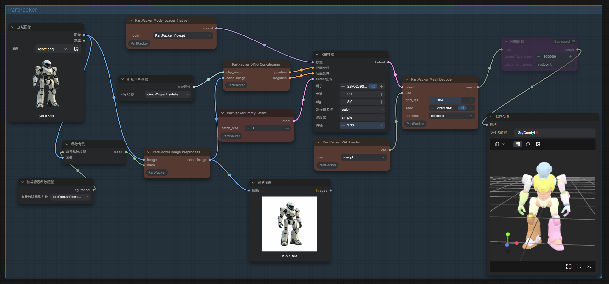

# ComfyUI_PartPacker
This is the comfyui implementation of [PartPacker](https://github.com/NVlabs/PartPacker): Efficient Part-level 3D Object Generation via Dual Volume Packing.Max varm12G


# Notice
* 使用comfyUI的核心代码封装，降低显存占用/user-friendly code for comfyUI, reduce GPU memory usage.

# 1. Installation

In the ./ComfyUI/custom_nodes directory, run the following:   
```
git clone https://github.com/smthemex/ComfyUI_PartPacker.git
```
---

# 2. Requirements  

```
pip install -r requirements.txt
```

# 3.Model
* 3.1 download  dit and vae   from [nvidia/PartPacker](https://huggingface.co/nvidia/PartPacker/tree/main) 从抱脸下载2个模型;  
* 3.1 dino  [facebook/dinov2-giant](https://huggingface.co/facebook/dinov2-giant/tree/main)
```
--  ComfyUI/models/diffusion_models/
    |-- flow.pth
--  vae/
    |-- vae.pt
--  clip_vision/
    |-- dinov2-giant.safetensors
```

# Example



# Acknowledgements
This work is built on many amazing research works and open-source projects, thanks a lot to all the authors for sharing!

[Dora](https://github.com/Seed3D/Dora)   
[Hunyuan3D-2](https://github.com/Tencent-Hunyuan/Hunyuan3D-2)   
[Trellis](https://github.com/microsoft/TRELLIS)   

# Citation
```
@article{tang2024partpacker,
  title={Efficient Part-level 3D Object Generation via Dual Volume Packing},
  author={Tang, Jiaxiang and Lu, Ruijie and Li, Zhaoshuo and Hao, Zekun and Li, Xuan and Wei, Fangyin and Song, Shuran and Zeng, Gang and Liu, Ming-Yu and Lin, Tsung-Yi},
  journal={arXiv preprint arXiv:2506.09980},
  year={2025}
}
```
